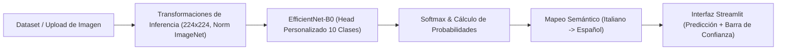

# Documentación Técnica: Clasificador de Animales
**Autor:** Roberto Alejandro Chagra Martínez  
**Tecnologías:** PyTorch, Torchvision (EfficientNet-B0), Streamlit, Pillow, NumPy, Scikit-Learn  
**Tipo:** Aplicación de Deep Learning para Visión por Computadora  

---

## 1. Descripción del Proyecto
Sistema integral de visión artificial modular para la clasificación supervisada de imágenes en 10 categorías de animales. Implementa técnicas de **Transfer Learning** sobre la red convolucional `EfficientNet-B0` y expone una interfaz gráfica web interactiva desarrollada en **Streamlit** para inferencia en tiempo real.



---

## 2. Estructura de Archivos y Componentes
* **[`src/app.py`](file:///g:/Mi%20unidad/Drive.alumno.udg.mx/Proyectos/Clasificador_de_Animales/src/app.py)**: Aplicación web en Streamlit. Maneja la carga en caché del modelo con `@st.cache_resource` desde `models/modelo.pth`, carga de imágenes del usuario, ejecución de inferencia en CPU/GPU (`cuda`) y traducción de etiquetas.
* **[`src/model_builder.py`](file:///g:/Mi%20unidad/Drive.alumno.udg.mx/Proyectos/Clasificador_de_Animales/src/model_builder.py)**: Definición de arquitecturas neuronales base con PyTorch (`nn.Module`), implementando `Model_Classification` (capas lineales densas con activaciones ReLU).
* **[`src/train.py`](file:///g:/Mi%20unidad/Drive.alumno.udg.mx/Proyectos/Clasificador_de_Animales/src/train.py)**: Pipeline de entrenamiento con Transfer Learning (`efficientnet_b0`), congelamiento de capas extractoras, optimizador Adam, función de pérdida (`CrossEntropyLoss`), validación por épocas y exportación de pesos a `models/modelo.pth`.
* **[`src/engine.py`](file:///g:/Mi%20unidad/Drive.alumno.udg.mx/Proyectos/Clasificador_de_Animales/src/engine.py)**: Funciones modulares de paso de entrenamiento (`train_step`) y evaluación (`test_step`).
* **[`src/dataset.py`](file:///g:/Mi%20unidad/Drive.alumno.udg.mx/Proyectos/Clasificador_de_Animales/src/dataset.py)**: Cargador y particionador dinámico (`70%` train, `15%` val, `15%` test) mediante `torchvision.datasets.ImageFolder`, `random_split` y `TransformedSubset`.
* **[`src/config.py`](file:///g:/Mi%20unidad/Drive.alumno.udg.mx/Proyectos/Clasificador_de_Animales/src/config.py)**: Configuración de rutas dinámicas relativas a la raíz del proyecto (`DATA_PATH`, `TRAIN_PATH`, `TEST_PATH`, `MODEL_PATH`), semilla de reproducibilidad (`SEED = 42`) e hiperparámetros.
* **[`src/translate.py`](file:///g:/Mi%20unidad/Drive.alumno.udg.mx/Proyectos/Clasificador_de_Animales/src/translate.py)**: Diccionario de traducción semántica de clases:
  * `cane` $\rightarrow$ perro | `cavallo` $\rightarrow$ caballo | `elefante` $\rightarrow$ elefante
  * `farfalla` $\rightarrow$ mariposa | `gallina` $\rightarrow$ gallina | `gatto` $\rightarrow$ gato
  * `mucca` $\rightarrow$ vaca | `pecora` $\rightarrow$ oveja | `ragno` $\rightarrow$ araña | `scoiattolo` $\rightarrow$ ardilla
* **[`src/get_data.py`](file:///g:/Mi%20unidad/Drive.alumno.udg.mx/Proyectos/Clasificador_de_Animales/src/get_data.py)**: Utilidad de carga tabular a tensores de PyTorch.
* **[`src/predict_image.py`](file:///g:/Mi%20unidad/Drive.alumno.udg.mx/Proyectos/Clasificador_de_Animales/src/predict_image.py)**: Script de inferencia por línea de comandos para evaluar imágenes locales individuales.

---

## 3. Especificación del Modelo
* **Backbone:** `torchvision.models.efficientnet_b0(weights=EfficientNet_B0_Weights.DEFAULT)`
* **Capa Clasificadora Reemplazada:**
  ```python
  in_features = model.classifier[1].in_features
  model.classifier[1] = nn.Linear(in_features=in_features, out_features=10)
  ```
* **Preprocesamiento y Data Augmentation:**
  * Redimensionamiento a $(224, 224)$ píxeles y `RandomHorizontalFlip(p=0.5)` en entrenamiento.
  * Conversión a tensor (`transforms.ToTensor()`).
  * Normalización estándar de ImageNet con medias `[0.485, 0.456, 0.406]` y desviaciones `[0.229, 0.224, 0.225]`.

---

## 4. Guía de Ejecución
1. Instalar dependencias desde la raíz del proyecto:
   ```bash
   pip install -r requirements.txt
   ```
2. Entrenar el modelo (opcional si ya se cuenta con `models/modelo.pth`):
   ```bash
   python src/train.py
   ```
3. Iniciar la aplicación web interactiva:
   ```bash
   streamlit run src/app.py
   ```
4. Subir una imagen (`.jpg`, `.jpeg`, `.png`) desde el navegador para obtener el animal detectado y la distribución porcentual de confianza.
